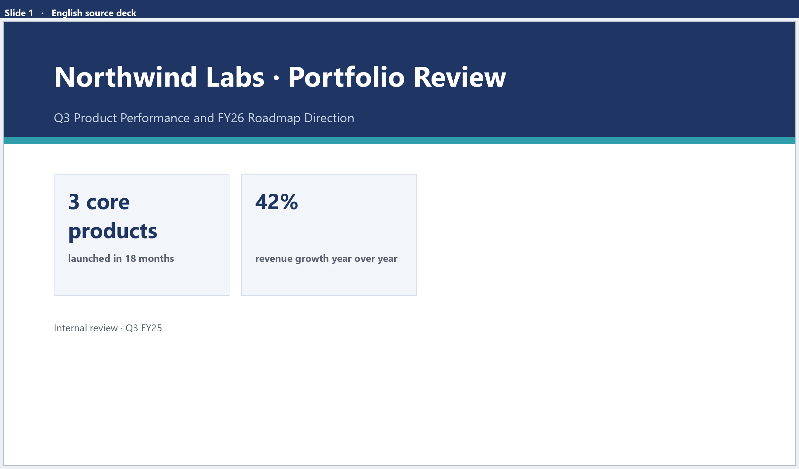
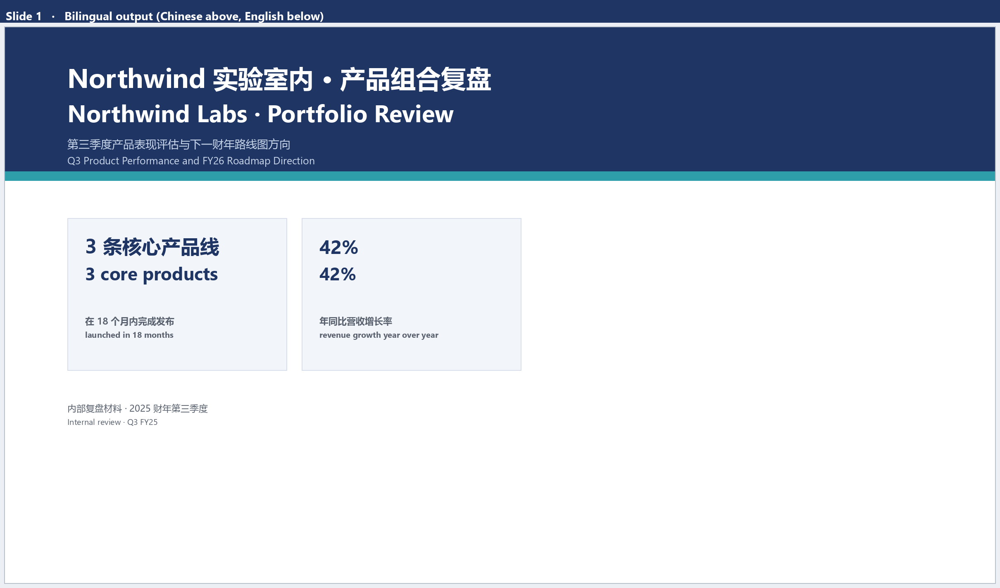
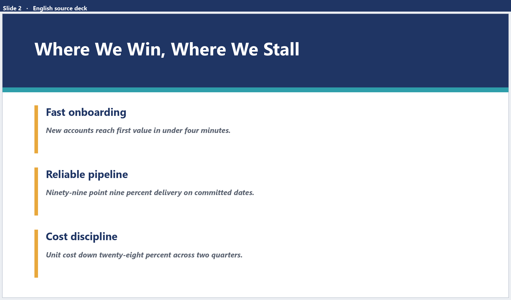
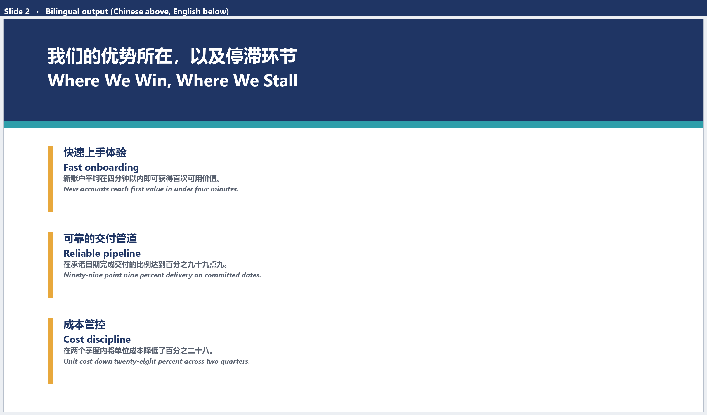
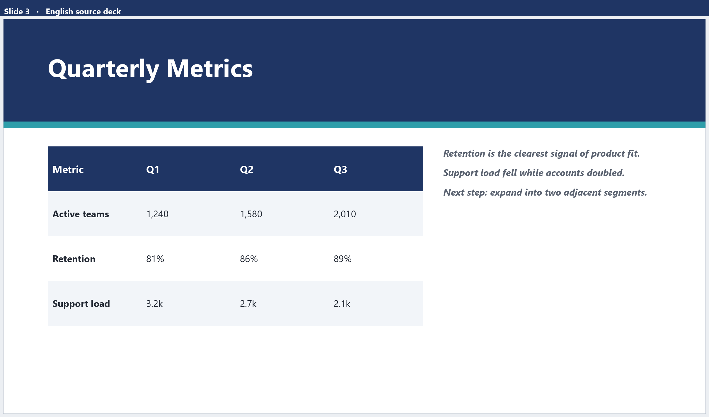
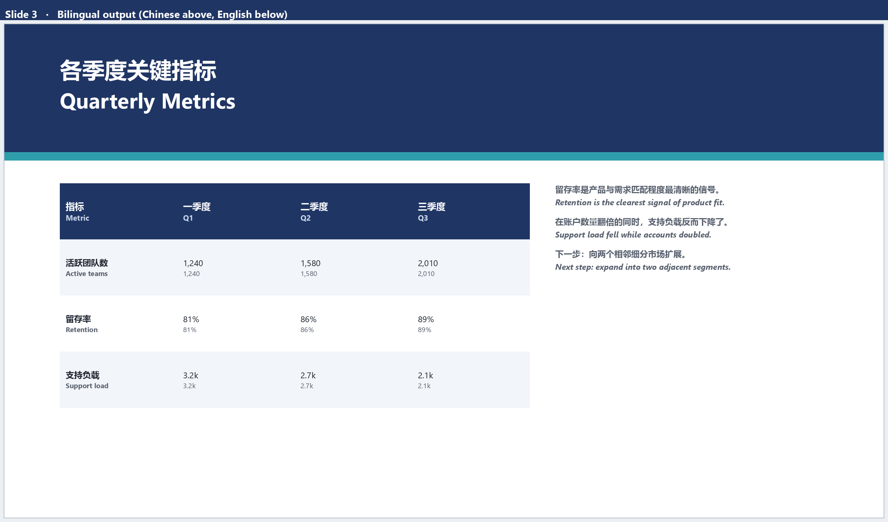

# FCI AI — 文档智能翻译系统

面向企业内部的 **PPT / PDF 文档翻译平台**，支持英文、中文、荷兰语互译。核心目标不是"把字翻出来"，而是 **翻译之后原文档的版式、配色、字体层级全部保持不变**——这是通用机翻工具最难解决、也最影响交付可用性的环节。

> ⚠️ **关于本仓库**
> - 本仓库为课题组横向项目的**公开快照（2025.09）**，仅用于技术展示。
> - 已移除全部客户端数据、生产配置、凭据与业务信息；不含任何真实文档样本。
> - 后续的生产版本由团队继续维护，功能多于本快照（如 OSS 直链解析链路），不在本仓库范围内。

---

## 效果

下方全部为**合成演示数据**（虚构公司 *Northwind Labs*、虚构指标），不含任何客户内容。

演示刻意让中文字符数明显多于英文——这正是通用机翻最容易把版式撑坏的情形。每组图给出两张：**左为英文原文，右为中英双语输出（中文在上、英文在下）**，可以看到文本框位置、卡片边界、强调色块、表格底纹与字体层级都保持原样，只有文字自身按原有宽度重新换行。

### Slide 1 · 标题页与数据卡片

| 英文原文 | 中英双语输出（上中下英） |
| :---: | :---: |
|  |  |

中文标题比英文长，卡片内 "3 core products" → "3 条核心产品线" 发生换行，但卡片尺寸、描边、配色与字号层级完全不变。

### Slide 2 · 多行正文与强调色块

| 英文原文 | 中英双语输出（上中下英） |
| :---: | :---: |
|  |  |

琥珀色竖条的位置与高度不动；正文的粗体/斜体样式在双语版本里由中英两行共同继承。

### Slide 3 · 表格单元格

| 英文原文 | 中英双语输出（上中下英） |
| :---: | :---: |
|  |  |

表头底纹、隔行底色、列宽与单元格内边距保持不变；每个单元格内中英文上下排布，右侧要点同样按原文本框宽度重排。

> 📄 三页对比合集：[`docs/demo-en-vs-bilingual.pdf`](docs/demo-en-vs-bilingual.pdf)
> 📎 演示源文件（可直接打开编辑）：[`docs/demo/demo-original-en.pptx`](docs/demo/demo-original-en.pptx) · [`docs/demo/demo-bilingual-zh-en.pptx`](docs/demo/demo-bilingual-zh-en.pptx) · [`docs/demo/demo-translated-zh.pptx`](docs/demo/demo-translated-zh.pptx)

<details>
<summary>如何复现这组图（<code>tools/</code>）</summary>

```bash
pip install python-pptx pillow

python tools/make_demo.py          # 生成 3 份合成 PPT 到 tools/_out/
python tools/render_pptx.py        # 渲染出 en-slide*.png / bi-slide*.png 与对比 PDF
```

`render_pptx.py` 是一个自包含的 PPTX 渲染器（python-pptx 读形状 + Pillow 绘制），不依赖 LibreOffice 或任何外部转换工具，字体在 Windows / macOS / Linux 上会自动回退。

之所以用合成数据而不是真实文档：客户内部资料不能公开，而本项目的展示重点恰好是**版式对文本内容不敏感**——用虚构内容演示，结论相同且零风险。

</details>

---

## 核心能力

| 能力 | 说明 |
|---|---|
| **版式保持翻译** | 段落/元素级翻译后原位回填，保持文本框、表格、组合形状的结构与样式 |
| **溢出与自适应** | 译文变长导致溢出时自动缩放字号/调整文本框，避免文字被裁切或压线 |
| **样式还原** | 字体属性、主题色、RGB 色值在翻译前后的备份与还原 |
| **多模型可切换** | Qwen3-235B、DeepSeek 等模型统一接口，支持按任务选择 |
| **术语表注入** | 用户维护的私有/公共术语表在翻译前注入，保证专业词汇译法一致 |
| **图片文字识别** | PPT/PDF 内嵌图片经 OCR 后纳入翻译，支持"跳过识别"开关 |
| **多用户平台** | 登录/SSO、注册审批、角色权限、任务队列、历史记录、词库管理 |
| **双语排版** | 支持原文/译文对照输出（段落上下或左右排列） |

---

## 我在这个项目中负责什么

> 该项目是 4 人协作的横向交付项目，由 **dancin、Ymk、yuyang 与我**共同完成。
> 为避免夸大，以下仅列出**由本人署名的提交**所覆盖的模块（可用 `git log --author=<me>` 核实）。

- **翻译主链路** — `app/function/ppt_translate.py`、`ppt_translate_async.py`、`page_based_translation.py`
  文档元素解析 → 分片 → 模型调用 → 元素级回填；按页切分以控制长文档上下文与调用成本。
- **格式保持** — `adjust_text_size.py`、`color_protection.py`、`smart_color_translation.py`、`color_backup_restore.py`、`preserve_textbox_size.py`、`pynuo_fuc/`
  溢出检测与自适应缩放、主题色/字体属性备份还原、LibreOffice UNO 跨进程读写复杂形状。
- **术语表体系** — `app/models/translation.py` 及词库前后端
  多语言词条模型、私有/公共可见性、分类标签与检索、批量导入导出，并接入翻译前注入流程。
- **OCR 链路** — `app/function/image_ocr/`
  图片文字识别与"跳过识别"选项，把原本无法翻译的图内文字纳入译文。
- **缺陷修复与前端** — 修复表格内容翻译后丢失的缺陷；实现中英双语前端与语言切换。

**团队分工说明**：任务队列调度、并发控制、部署运维由队友负责；本人在此基础上完成翻译算法链路，并阅读了整体架构以保证模块在并发环境下的正确性。

---

## 处理流程

```
                 ┌──────────── 上传 PPT/PDF ────────────┐
                 │                                      │
          ┌──────▼──────┐                       ┌───────▼───────┐
          │  PPT 解析    │                       │  PDF 解析/OCR  │
          │ python-pptx │                       │  PyMuPDF 等   │
          └──────┬──────┘                       └───────┬───────┘
                 │  元素(文本框/表格/组合形状/图片)        │
                 └───────────────┬──────────────────────┘
                                 ▼
                    ┌────────────────────────┐
                    │ 文本分片 (按页 + 批大小) │
                    └────────────┬───────────┘
                                 ▼
                 ┌───────────────────────────────┐
                 │ 术语表注入 → LLM 翻译           │
                 │ Qwen3-235B / DeepSeek         │
                 │ 并发请求 + 退避重试 + 容灾端点   │
                 └───────────────┬───────────────┘
                                 ▼
                    ┌────────────────────────┐
                    │ 元素级回填 + 表格处理    │
                    └────────────┬───────────┘
                                 ▼
              ┌──────────────────────────────────┐
              │ 版式校验：溢出检测 / 自适应缩放      │
              │ 样式还原：字体、主题色、颜色        │
              └────────────────┬─────────────────┘
                               ▼
                      输出译文（单语/双语）
```

---

## 技术栈

- **Web**：Flask 3.0 · Jinja2 · Flask-SQLAlchemy · Flask-Login
- **文档处理**：python-pptx · PyMuPDF · python-docx · openpyxl
- **格式引擎**：LibreOffice UNO（`pynuo_fuc/`）— 跨进程读写 PPT 复杂形状与样式
- **模型**：Qwen3-235B（DashScope 兼容模式）· DeepSeek · Qwen-VL-OCR
- **异步与并发**：asyncio · httpx · 线程池 · 任务队列
- **数据**：MySQL / SQLite · Redis（可选缓存）
- **认证**：OAuth2 / OIDC（SSO 抽象层）
- **运维**：gunicorn · psutil/GPUtil 监控 · 分环境配置

---

## 快速开始

```bash
# 1) 依赖
python -m venv .venv && source .venv/bin/activate   # Windows: .venv\Scripts\activate
pip install -r requirements.txt

# 2) 配置
cp .env.example .env
# 编辑 .env，至少填写 SECRET_KEY、QWEN_API_KEY 与数据库配置

# 3) 初始化数据库
python setup_database.py

# 4) 启动
python run.py
# 打开 http://127.0.0.1:5000
```

**前置要求**：Python 3.9+；如需 PPT 复杂形状与自适应能力，需本机安装 **LibreOffice** 并在 `.env` 中配置 `SOFFICE_PATH`。缺少 LibreOffice 时，纯 python-pptx 的解析与回填路径仍可运行。

---

## 目录结构

```
app/
├── function/                  # 核心能力
│   ├── ppt_translate*.py      # PPT 翻译主链路
│   ├── page_based_translation.py
│   ├── adjust_text_size.py    # 文本框自适应
│   ├── color_*.py             # 颜色备份/还原
│   ├── local_qwen_async.py    # Qwen 异步客户端
│   ├── image_ocr/             # 图片 OCR
│   └── pynuo_fuc/             # LibreOffice UNO 接口
├── models/                    # 用户 / 任务 / 词库模型
├── views/                     # 蓝图与路由
├── services/                  # SSO、用户服务
├── utils/                     # 任务队列、线程池、日志、监控
├── templates/                 # 页面（中英双语）
└── static/                    # 前端资源
```

---

## 已知限制

- 本快照不含客户端数据与生产部署配置，需自行准备模型 Key 与数据库。
- 复杂形状（组合、图表、SmartArt）的还原依赖 LibreOffice 版本，不同版本表现可能略有差异。
- 面向企业内部的特定文档类型做了大量针对性处理，通用性边界以实际文档为准。

---

## 许可与致谢

- 本项目为课题组横向项目，代码版权归属依原始项目约定；本仓库仅作技术展示，**不构成商业分发**。
- 感谢协作伙伴 dancin、Ymk、yuyang 以及指导老师的支持。
- 若你是项目相关方并认为本仓库内容不妥，请联系我，我会立即处理。
